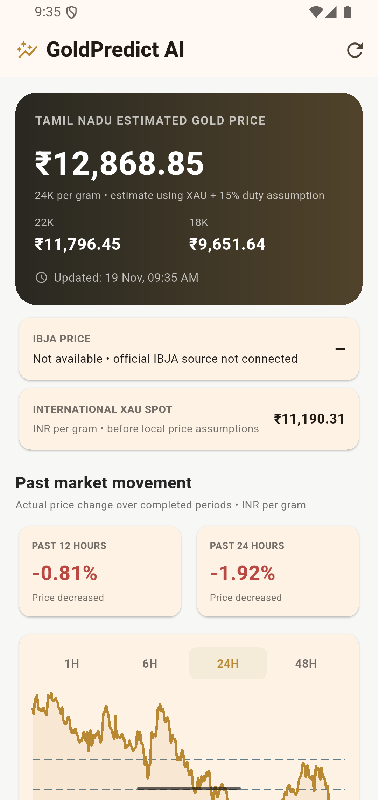
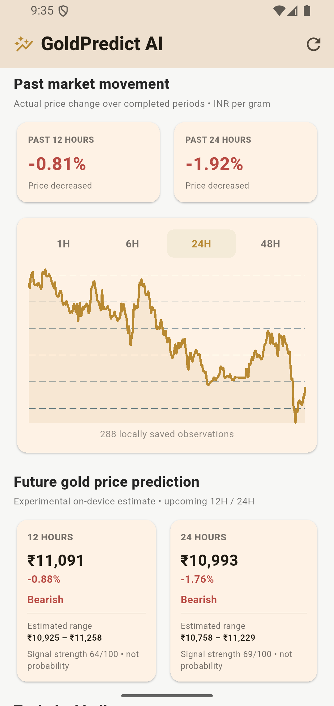
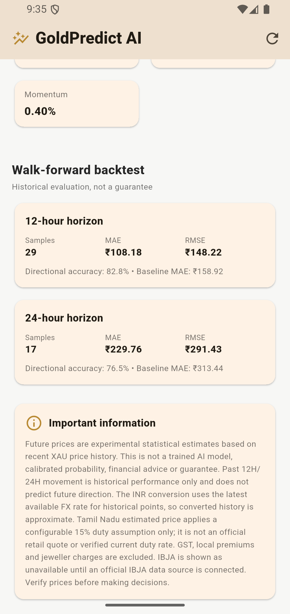

# GoldPredict AI — Flutter-only source starter

<!-- 

 -->

<p align="center">
  
  
  
</p>

<!-- 

 -->


Includes GetX dashboard, indicative INR/gram 24K spot quote, intraday chart, local SQLite storage, 15-minute OHLC candles, EMA 12/26, RSI 14, MACD, ATR, volatility approximation, momentum, 12h/24h statistical forecasts, and chronological walk-forward backtest metrics.

## No backend or API key
Forecast calculations run in Dart on-device. SQLite stores local observations. No Python backend, Firebase, or custom server is included. A live price still requires internet access and a third-party provider.

Configured public endpoints (not verified in this environment):
- `https://xaus.com/api/v1/spot?currency=INR&unit=gram&compact=1`
- `https://xaus.com/api/v1/intraday?symbol=xau&hours=48`
- Provider project: `https://github.com/misix-git/xaus-api`

The parser assumes common JSON field names. Confirm current provider schema, units, terms, rate limits and uptime before production use; adapt `market_data_provider.dart` if needed.

The displayed spot quote is not guaranteed to equal local Indian jeweller retail price. GST, import duty, local premiums and jeweller charges may be excluded. Forecasts are experimental statistical estimates, not trained ML/deep learning, financial advice or guarantees. Signal score is heuristic, not calibrated probability. Backtesting needs sufficient accumulated history; a short feed cannot establish robust 12h/24h performance. OS background execution cannot guarantee exact periodic refresh when the app is terminated.

## Run
Install Flutter, extract the ZIP, open this folder and run:
```bash
flutter create --platforms=android,ios .
flutter pub get
flutter run
flutter analyze
flutter test
```
If native platform folders already exist, preserve their configuration. Ensure Android `AndroidManifest.xml` includes `<uses-permission android:name="android.permission.INTERNET" />` above `<application>`.

This is source code, not a prebuilt APK/IPA. It has not been compiled on your device or verified against live provider responses.


Explanation Tamil & English Here:

//==================== Project Flow in English

# GoldPredict AI – Flutter Application

## 1. Project Overview

**GoldPredict AI** is a Flutter-based gold price monitoring and future price prediction application.

The main objective is to monitor international gold prices, estimate Tamil Nadu gold prices, analyze historical market movements, and predict potential gold prices for the upcoming 12 and 24 hours.

The application retrieves live gold market data from **xaus.com**, processes historical price information, calculates technical indicators, and generates statistical forecasts.

### Main Features

- Live international gold price in INR per gram.
- Estimated Tamil Nadu gold prices for 24K, 22K, and 18K.
- Historical gold price charts.
- Past 12-hour and 24-hour market movement.
- Future 12-hour and 24-hour gold price predictions.
- Technical indicators such as EMA, RSI, MACD, ATR, volatility, and momentum.
- Historical prediction performance evaluation through backtesting.
- Local SQLite database storage.
- Automatic market data refresh.

## 2. Technology Stack

| Technology | Purpose |
|---|---|
| Flutter | Mobile application development |
| Dart | Application programming language |
| GetX | State management |
| SQLite (sqflite) | Local database storage |
| HTTP | API communication |
| fl_chart | Historical price charts |
| intl | Date and time formatting |
| xaus.com API | Gold market data source |

**Architecture:** The application currently operates without Firebase or a custom backend server. Market data is retrieved directly from the xaus.com API and stored locally using SQLite.

## 3. Market Data API Integration

The application uses two API endpoints from xaus.com.

### 3.1 Live Gold Price API

Endpoint:

```text
https://xaus.com/api/v1/spot?currency=INR&unit=gram&compact=1
```

This API provides the current international gold price converted into Indian Rupees per gram.

Example response:

```json
{
  "xau": {
    "price": 11662.0145,
    "currency": "INR",
    "unit": "gram"
  },
  "spot_usd_oz": 3860.469971,
  "per_gram_usd": 124.117,
  "fx_rate": 93.959855,
  "fx_stale": false,
  "source": "xaus.com"
}
```

Important response fields:

- `xau.price`: International gold price in INR per gram.
- `spot_usd_oz`: Gold price in USD per troy ounce.
- `per_gram_usd`: Gold price in USD per gram.
- `fx_rate`: USD to INR exchange rate.
- `source`: Market data source.

The application uses `xau.price` as the current international gold price.

### 3.2 Historical Gold Price API

Endpoint:

```text
https://xaus.com/api/v1/intraday?symbol=xau&hours=48
```

This API retrieves approximately 48 hours of historical gold price observations.

Example response:

```json
{
  "symbol": "xau",
  "hours": 48,
  "currency": "USD",
  "unit": "troy_oz",
  "interval_seconds": 300,
  "points": [
    {
      "t": 1794780014,
      "p": 3887.600098
    }
  ],
  "count": 472,
  "source": "xaus.com"
}
```

The historical API provides:

- `t`: Unix timestamp.
- `p`: Gold price in USD per troy ounce.
- `interval_seconds`: Observation interval.

The historical price is converted into INR per gram before being used by the application.

### 3.3 USD to INR and Troy Ounce Conversion

One troy ounce equals:

```text
31.1034768 grams
```

The application converts historical prices using:

```dart
inrPerGram = usdPerOunce * fxRate / 31.1034768;
```

For example:

```text
Historical Gold Price = $3,887.60 per troy ounce
USD to INR Rate       = ₹93.95

INR per gram = (3887.60 × 93.95) / 31.1034768
```

The result is the historical international gold price in INR per gram.

**Important limitation:** The historical API does not provide historical USD-to-INR exchange rates. Therefore, the application applies the latest available exchange rate to historical USD prices. Historical INR prices are consequently approximate rather than exact historical INR market values.

## 4. International and Tamil Nadu Gold Price Calculation

The application displays two different price categories.

### 4.1 International Gold Price

The international gold price is obtained directly from the live API.

```text
International Gold Price = XAU Spot Price in INR per Gram
```

This price represents international gold market pricing converted into INR per gram.

It does not include local Indian retail adjustments.

### 4.2 Tamil Nadu Estimated Gold Price

The application calculates an estimated Tamil Nadu gold price using a configurable 15% modelling assumption.

File:

```text
lib/services/gold_price_calculator.dart
```

Calculation:

```dart
static const double importDutyAssumption = 0.15;

final estimated24K =
    internationalInrPerGram * (1 + importDutyAssumption);
```

The 24K estimated price is calculated as:

```text
Estimated 24K Price = International Price × 1.15
```

For 22K:

```text
Estimated 22K Price = Estimated 24K Price × (22 / 24)
```

For 18K:

```text
Estimated 18K Price = Estimated 24K Price × (18 / 24)
```

Example:

```text
International Gold Price = ₹11,662.01 per gram

Estimated 24K = 11,662.01 × 1.15
              = ₹13,411.31

Estimated 22K = 13,411.31 × (22 / 24)

Estimated 18K = 13,411.31 × (18 / 24)
```

**Important:** The 15% value is an editable modelling assumption. It is not a verified current Indian import duty rate or an official Tamil Nadu gold pricing formula.

The calculation does not include:

- GST.
- Jeweller premiums.
- Making charges.
- Wastage charges.
- Local retail price adjustments.

Therefore, these values are estimated prices, not guaranteed jewellery shop prices.

## 5. IBJA Gold Price

The dashboard contains a separate section for the IBJA gold price.

However, the current application does not have an official IBJA API or verified IBJA data source connected.

Therefore:

```text
IBJA Price = Not Available
```

The application does not generate or assume an IBJA price from international gold prices.

To display actual IBJA prices in the future, an official or otherwise reliable IBJA data source must be integrated.

## 6. Historical Price Data Processing

File:

```text
lib/data/providers/market_data_provider.dart
```

The application retrieves historical price observations and processes them into a common format.

Each historical observation contains:

- Date and time.
- Gold price in INR per gram.

The timestamps are converted from Unix seconds into Dart `DateTime` objects.

The historical observations are sorted chronologically.

The application then merges:

1. Historical API observations.
2. Previously stored SQLite observations.
3. The latest live spot price.

Observations are merged using their timestamps to avoid duplicate records.

This processed historical data is used for charts, technical indicators, predictions, and backtesting.

## 7. Candlestick Generation

File:

```text
lib/services/candle_service.dart
```

The application converts historical price observations into 15-minute candlesticks.

Each candlestick contains four values:

| Value | Meaning |
|---|---|
| Open | First observed price in the 15-minute period |
| High | Highest observed price |
| Low | Lowest observed price |
| Close | Last observed price |

Example:

```text
15-minute candle:

Open  = ₹11,650
High  = ₹11,675
Low   = ₹11,640
Close = ₹11,668
```

The application groups observations into 15-minute time buckets using timestamps.

### Candlestick Time Calculation

```text
1 Candle = 15 Minutes

1 Hour   = 4 Candles
4 Hours  = 16 Candles
12 Hours = 48 Candles
24 Hours = 96 Candles
```

These candles are used by the prediction engine, technical indicator calculations, and backtesting service.

## 8. Past 12-Hour and 24-Hour Market Movement

The dashboard displays:

- Past 12H percentage change.
- Past 24H percentage change.

These values represent historical market movement, not future predictions.

The application finds the latest observation and compares it with the last available observation at or before the required historical cutoff.

Formula:

```text
Percentage Change =
((Latest Price - Previous Price) / Previous Price) × 100
```

Equivalent calculation:

```dart
return (latest.price / baseline.price - 1) * 100;
```

Example:

```text
Price 12 hours ago = ₹11,700
Current Price      = ₹11,650

Change = ((11650 - 11700) / 11700) × 100

Change = -0.43%
```

Interpretation:

- Positive percentage: Gold price increased during the completed period.
- Negative percentage: Gold price decreased during the completed period.
- Zero percentage: No price change.

If the application does not have enough historical data to find a suitable baseline, it displays `—`.

**Important distinction:**

- Past 12H / 24H shows what happened in the market.
- Future 12H / 24H shows what the prediction engine estimates may happen next.

## 9. Future Gold Price Prediction Engine

File:

```text
lib/services/forecast_engine.dart
```

The application uses a lightweight statistical forecasting algorithm to estimate future gold prices.

It is not currently a trained machine learning or deep learning model.

The prediction engine analyzes historical candlestick closing prices and calculates:

- Historical log returns.
- Market drift.
- EMA-based trend.
- Price momentum.
- Historical volatility.

These values are combined to estimate future price movement.

### 9.1 Minimum Historical Data Requirement

The prediction engine requires at least:

```text
32 Candles = Approximately 8 Hours
```

Since each candle represents 15 minutes, 32 candles provide approximately eight hours of historical data.

### 9.2 Log Return Calculation

The engine first calculates the logarithmic return between consecutive candle closing prices.

Formula:

```text
Log Return = ln(Current Close / Previous Close)
```

Dart implementation:

```dart
log(closes[i] / closes[i - 1]);
```

Log returns help the prediction engine analyze historical price movements.

### 9.3 Market Drift Calculation

The engine calculates average historical returns over different periods:

| Period | Candles |
|---|---:|
| 4 Hours | 16 |
| 12 Hours | 48 |
| 24 Hours | 96 |

The drift calculation is:

```dart
driftPerBar =
    (_mean(recent4h) * 0.50 +
     _mean(recent12h) * 0.30 +
     _mean(recent24h) * 0.20) * 0.55;
```

The weights are:

- 4-hour movement: 50%.
- 12-hour movement: 30%.
- 24-hour movement: 20%.

The resulting value is multiplied by 0.55 to reduce the influence of historical drift.

If sufficient historical observations are unavailable for a particular period, the engine uses the available observations.

### 9.4 EMA-Based Trend Calculation

The prediction engine calculates:

- EMA 16.
- EMA 48.

EMA means Exponential Moving Average.

It helps identify the general direction of historical gold prices.

The trend component is:

```dart
trendPerBar =
    (log(emaFast / emaSlow) / 48) * 0.20;
```

Where:

- `emaFast` represents EMA 16.
- `emaSlow` represents EMA 48.

If EMA 48 cannot be calculated, the trend component is set to zero.

### 9.5 Momentum Calculation

The engine also calculates recent price momentum.

4-hour momentum:

```dart
momentum4h =
    log(last / closes[closes.length - 17]) / 16;
```

12-hour momentum:

```dart
momentum12h =
    log(last / closes[closes.length - 49]) / 48;
```

Combined momentum:

```dart
momentumPerBar =
    (momentum4h * 0.65 +
     momentum12h * 0.35) * 0.15;
```

This gives greater weight to recent 4-hour momentum.

If the required historical values are unavailable, the engine uses the available data according to its implementation.

### 9.6 Expected Future Return

The engine combines:

- Market drift.
- EMA trend.
- Price momentum.

Formula:

```dart
expectedLogReturnPerBar =
    (driftPerBar +
     trendPerBar +
     momentumPerBar)
    .clamp(-0.00020, 0.00020);
```

The clamp limits the estimated log return per 15-minute candle.

This is a model guardrail to prevent excessive extrapolation. It is not a market price limit.

### 9.7 Future Price Calculation

The prediction engine calculates future prices using exponential growth based on the expected log return.

Formula:

```dart
predictedPrice =
    last * exp(expectedLogReturnPerBar * horizonBars);
```

Where:

- `last`: Latest candle closing price.
- `expectedLogReturnPerBar`: Estimated return per candle.
- `horizonBars`: Number of candles in the forecast period.

For a 12-hour forecast:

```text
12 Hours × 4 = 48 Candles
```

For a 24-hour forecast:

```text
24 Hours × 4 = 96 Candles
```

Therefore:

```text
12H Predicted Price =
Latest Price × exp(Expected Return × 48)
```

```text
24H Predicted Price =
Latest Price × exp(Expected Return × 96)
```

The percentage change is calculated using:

```dart
(exp(expectedLogReturn) - 1) * 100;
```

The forecast is based on the international XAU spot price converted into INR per gram. It does not predict the Tamil Nadu estimated retail price.

### 9.8 Prediction Direction

The application classifies the predicted direction using the expected percentage movement.

| Expected Movement | Direction |
|---|---|
| Greater than +0.05% | Bullish |
| Less than -0.05% | Bearish |
| Between -0.05% and +0.05% | Neutral |

Interpretation:

- Bullish: The model estimates an upward price movement.
- Bearish: The model estimates a downward price movement.
- Neutral: The estimated movement is relatively small.

## 10. Predicted Low and High Price Range

The application calculates an estimated price range around the predicted price.

The calculation uses historical volatility and the forecast horizon.

Formula:

```dart
range =
    last * volatility * sqrt(horizonBars) * 1.28;
```

Then:

```dart
low = max(0, predictedPrice - range);

high = predictedPrice + range;
```

The dashboard displays:

- Predicted price.
- Estimated low price.
- Estimated high price.

This range provides an indication of possible price variation based on historical volatility.

**Important:** This is a rough statistical range. It is not a guaranteed future minimum or maximum and is not a formally calibrated confidence interval.

## 11. Signal Strength Calculation

The application calculates a heuristic signal strength value.

Formula:

```dart
expectedMoveInVolUnits =
    volatility <= 0
        ? 0
        : abs(expectedLogReturn) /
          (volatility * sqrt(horizonBars));

signalStrength =
    clamp(50 + expectedMoveInVolUnits * 18, 50, 75);
```

The resulting score ranges from:

```text
50 to 75
```

This value measures the size of the estimated movement relative to historical volatility.

**Important:** Signal strength is not a prediction probability, confidence percentage, or verified accuracy score.

For example:

```text
Signal Strength = 65
```

It does not mean there is a 65% chance that the prediction will be correct.

## 12. Technical Indicators

File:

```text
lib/services/indicator_service.dart
```

The application calculates several technical indicators from historical candlestick data.

### 12.1 EMA 12 and EMA 26

EMA means Exponential Moving Average.

The application calculates:

- EMA 12.
- EMA 26.

These indicators help identify short-term and longer-term price trends.

General interpretation:

- EMA 12 above EMA 26: Positive trend indication.
- EMA 12 below EMA 26: Negative trend indication.

The EMA implementation initializes using a simple average of the first period's values and then applies the standard recursive EMA calculation.

### 12.2 RSI 14

RSI means Relative Strength Index.

The application calculates RSI using a 14-period calculation with Wilder-style smoothed average gains and losses.

RSI formula:

```text
RS = Average Gain / Average Loss

RSI = 100 - (100 / (1 + RS))
```

General interpretation:

| RSI Value | Interpretation |
|---|---|
| Above 70 | Potentially overbought |
| Below 30 | Potentially oversold |
| 30–70 | Middle range |

RSI is an analytical indicator, not a guarantee of future price movement.

### 12.3 MACD

MACD means Moving Average Convergence Divergence.

The application calculates:

```text
MACD = EMA 12 - EMA 26
```

It helps identify changes in momentum and trend direction.

The current implementation displays the MACD value calculated from EMA 12 and EMA 26.

### 12.4 ATR 14

ATR means Average True Range.

The application calculates True Range using:

```text
True Range = Maximum of:

High - Low
Absolute(High - Previous Close)
Absolute(Low - Previous Close)
```

ATR 14 is calculated as the simple average of the latest 14 True Range values.

ATR helps measure historical price movement and volatility.

It does not indicate whether the price will increase or decrease.

### 12.5 Volatility

The application calculates historical percentage returns:

```text
Return = (Current Close / Previous Close) - 1
```

It then calculates sample standard deviation and scales it using:

```text
Volatility = Standard Deviation × sqrt(96) × 100
```

This is a daily-style volatility measure based on 15-minute observations. It is not annualized volatility.

### 12.6 Momentum

Momentum compares the latest closing price with the closing price four candles earlier.

```dart
(v.last / v[v.length - 5] - 1) * 100;
```

Since each candle represents 15 minutes, this measures approximately one hour of price momentum.

## 13. Historical Prediction Performance – Backtesting

File:

```text
lib/services/backtest_service.dart
```

The application includes a backtesting system to evaluate how the prediction algorithm would have performed on historical market data.

Instead of using future information, the backtesting process evaluates historical periods chronologically.

### 13.1 Walk-Forward Backtesting

The process works as follows:

1. Select a historical forecast starting point.
2. Use only the candles available before that point.
3. Generate a prediction using the same Forecast Engine.
4. Move forward by the required forecast horizon.
5. Compare the predicted price with the actual historical price.
6. Calculate prediction errors.
7. Repeat the process for additional historical starting points.

The application uses every fourth candle as a forecast starting point, which represents approximately one-hour intervals.

The forecast windows overlap, so individual test samples are not fully independent.

### 13.2 Backtesting Minimum Data Requirements

The implementation requires at least 36 training candles in addition to the forecast horizon.

| Forecast | Required Candles | Approximate Historical Duration |
|---|---:|---:|
| 12 Hours | 48 + 36 = 84 | 21 Hours |
| 24 Hours | 96 + 36 = 132 | 33 Hours |

The current API retrieves approximately 48 hours of historical data.

Although this may be enough to perform some 24-hour backtesting, the number of available test samples may be limited.

More historical data is required for a more meaningful performance evaluation.

### 13.3 MAE – Mean Absolute Error

MAE measures the average absolute difference between predicted prices and actual prices.

Formula:

```text
MAE = Sum of Absolute Prediction Errors / Number of Samples
```

Example:

```text
Prediction 1 Error = ₹50
Prediction 2 Error = ₹40
Prediction 3 Error = ₹50

MAE = (50 + 40 + 50) / 3

MAE = ₹46.67
```

Interpretation:

If MAE is ₹46.67, the average absolute prediction error across the evaluated samples is ₹46.67 per gram.

Generally, a lower MAE indicates better price prediction accuracy on the evaluated historical dataset.

### 13.4 RMSE – Root Mean Square Error

RMSE measures prediction errors while giving greater weight to larger errors.

Formula:

```text
RMSE = Square Root of Average Squared Errors
```

Example:

```text
Errors = 50, 40, 50

RMSE = sqrt((50² + 40² + 50²) / 3)

RMSE = sqrt(2200)

RMSE ≈ ₹46.90
```

Interpretation:

- Lower RMSE is generally better.
- Larger prediction errors have a greater influence on RMSE than on MAE.

### 13.5 Directional Accuracy

Directional accuracy measures how often the model correctly predicts whether the price will move up or down.

Example:

```text
Actual Movement    Predicted Movement
-------------------------------------
Price Increased    Increased
Price Decreased    Decreased
Price Increased    Decreased
Price Decreased    Decreased
```

In this example:

```text
Correct Directions = 3
Eligible Predictions = 4

Directional Accuracy = (3 / 4) × 100

Directional Accuracy = 75%
```

The application excludes samples where the actual or predicted movement is extremely close to zero.

Directional accuracy evaluates the direction of movement, not the exact predicted price.

### 13.6 Baseline MAE

The application also calculates a baseline prediction.

The baseline assumes that the future gold price will remain unchanged from the starting price.

Example:

```text
Starting Price = ₹11,650

Baseline Future Prediction = ₹11,650
```

The baseline error is compared with the actual future price.

This allows the application to evaluate whether the prediction model performs better than a simple price-unchanged assumption.

Interpretation:

- Model MAE lower than Baseline MAE: The model performed better than the unchanged-price baseline on the evaluated historical samples.
- Model MAE higher than Baseline MAE: The model performed worse than the unchanged-price baseline.

### 13.7 Backtesting Samples

The dashboard displays the number of successfully evaluated historical prediction samples.

A larger sample count generally provides more information about historical performance.

However, the number of samples alone does not guarantee that the model is accurate. The overlapping forecast windows also mean that samples are not fully independent.

## 14. SQLite Local Database

File:

```text
lib/data/local/app_database.dart
```

The application uses SQLite to store historical market observations and generated candlesticks locally.

Database name:

```text
goldpredict_ai.db
```

### 14.1 Prices Table

Stores historical gold price observations.

| Column | Type | Purpose |
|---|---|---|
| time | INTEGER | Observation timestamp |
| price | REAL | Gold price in INR per gram |

The timestamp is used as the primary key to avoid duplicate observations.

### 14.2 Candles Table

Stores generated 15-minute candlestick records.

| Column | Type | Purpose |
|---|---|---|
| time | INTEGER | Candle timestamp |
| open | REAL | Opening price |
| high | REAL | Highest price |
| low | REAL | Lowest price |
| close | REAL | Closing price |

### 14.3 Database Upgrade

The database currently uses version 2.

During the upgrade from the previous database version, old price and candle records are cleared because the historical price unit changed to INR per gram.

This prevents old USD-per-troy-ounce records from being mixed with the new INR-per-gram records.

### 14.4 Data Loading Process

When the application opens:

1. Previously stored SQLite records are loaded.
2. The application retrieves the latest spot price.
3. It retrieves historical market data.
4. API and local observations are merged.
5. The latest spot observation is added.
6. Updated observations are saved in SQLite.
7. Candlesticks are regenerated.
8. Technical indicators and predictions are recalculated.
9. The dashboard is updated.

SQLite allows the application to retain historical records locally between application sessions.

## 15. Dashboard Screen Structure

The main dashboard contains the following sections.

### 15.1 Tamil Nadu Estimated Gold Price

Displays:

- Estimated 24K price.
- Estimated 22K price.
- Estimated 18K price.
- Last updated time.

These prices are calculated using the international XAU spot price and the configurable 15% modelling assumption.

### 15.2 IBJA Price

Displays the IBJA price section.

Currently, the value is unavailable because an official IBJA data source has not been integrated.

### 15.3 International XAU Spot Price

Displays the latest international gold price in INR per gram.

This is the main price used by the historical chart and forecasting engine.

### 15.4 Past Market Movement

Displays:

- Past 12-hour price change.
- Past 24-hour price change.

These values show historical market performance.

### 15.5 Historical Gold Price Chart

Displays historical gold price movement.

Available chart ranges:

- 1 Hour.
- 6 Hours.
- 24 Hours.
- 48 Hours.

The chart uses stored historical price observations.

### 15.6 Future Gold Price Prediction

Displays:

- 12-hour predicted gold price.
- 24-hour predicted gold price.
- Expected percentage movement.
- Bullish, bearish, or neutral direction.
- Estimated low and high price range.
- Signal strength.

These values are generated by the statistical Forecast Engine.

### 15.7 Technical Indicators

Displays:

- EMA 12.
- EMA 26.
- RSI 14.
- MACD.
- ATR 14.
- Volatility.
- Momentum.

These indicators help users understand historical price trends and market behaviour.

### 15.8 Backtesting Results

Displays:

- Number of evaluated samples.
- MAE.
- RMSE.
- Directional accuracy.
- Baseline MAE.

These values help evaluate the historical performance of the prediction algorithm.

## 16. Current Project Limitations

The current version has the following limitations:

1. **Not a trained AI model:** The prediction engine uses statistical calculations rather than a trained machine learning model.

2. **Limited historical data:** The current historical API retrieves approximately 48 hours of observations. More historical data would improve backtesting coverage.

3. **Approximate historical INR conversion:** The latest USD-to-INR exchange rate is applied to historical USD gold prices because historical FX rates are not provided by the current API integration.

4. **Estimated Tamil Nadu prices:** The 15% modelling assumption is not a verified official import duty rate or retail pricing formula.

5. **GST and jewellery charges excluded:** GST, making charges, wastage, and jeweller premiums are not included in the estimated prices.

6. **IBJA integration unavailable:** No official IBJA price source is currently connected.

7. **No external market news analysis:** The prediction engine does not currently analyze economic news, geopolitical events, central bank decisions, or other external market factors.

8. **No trained model validation:** The current algorithm has not been established as a reliably accurate forecasting model through independent validation.

9. **No guaranteed predictions:** Gold prices can change unexpectedly due to market conditions. Predictions and estimated ranges are not guaranteed future prices.

## 17. Future Improvements

The following enhancements could be considered for future versions:

- Integrate a reliable official IBJA data source.
- Retrieve longer historical gold price data.
- Integrate historical USD-to-INR exchange rates.
- Improve the prediction algorithm using machine learning.
- Evaluate models such as Linear Regression, Random Forest, XGBoost, or LSTM.
- Add additional market indicators and external economic data.
- Improve backtesting with larger datasets and more robust validation.
- Compare multiple forecasting algorithms.
- Display historical prediction accuracy over different periods.
- Add prediction performance reports.
- Introduce configurable price alerts and notifications.
- Add cloud backup and synchronization if required.

These are potential future enhancements, not features currently implemented.

## 18. Final Project Summary

GoldPredict AI is a Flutter-based gold price monitoring and statistical forecasting application.

The current application follows this overall process:

```text
xaus.com Market API
        |
        v
Live and Historical Gold Prices
        |
        v
USD to INR / Troy Ounce Conversion
        |
        v
Historical Price Processing
        |
        v
SQLite Local Storage
        |
        v
15-Minute Candlestick Generation
        |
        v
Technical Indicator Calculation
        |
        v
Statistical Forecast Engine
        |
        v
12-Hour and 24-Hour Predictions
        |
        v
Historical Backtesting
        |
        v
Flutter Dashboard
```

The main purpose is to provide users with:

- Current international gold prices.
- Estimated Tamil Nadu gold prices.
- Historical market movement.
- Future 12-hour and 24-hour statistical forecasts.
- Technical market indicators.
- Historical prediction performance measurements.

**Final Note:** GoldPredict AI is currently a statistical gold price analysis and forecasting application. Its predictions are estimates based on historical price behaviour and should not be treated as guaranteed market outcomes or financial advice.


//==================== Project Flow in Tamil


# GoldPredict AI – முழுமையான தொழில்நுட்ப விளக்கம் (தமிழ்)

## 1. Project Overview – திட்டத்தின் நோக்கம்

GoldPredict AI என்பது தங்கத்தின் தற்போதைய விலை, கடந்த கால விலை மாற்றங்கள் மற்றும் எதிர்கால விலை கணிப்புகளை ஒரே Dashboard-ல் காண்பிக்கும் Flutter Mobile Application ஆகும்.

இந்த செயலியின் முக்கிய நோக்கம்:

- தற்போதைய International Gold Spot Price-ஐ பெறுவது.
- இந்திய ரூபாயில் ஒரு கிராமுக்கான தங்க விலையைக் கணக்கிடுவது.
- Tamil Nadu Estimated Gold Price-ஐக் காட்டுவது.
- கடந்த 12 மணி மற்றும் 24 மணி நேர விலை மாற்றங்களைக் கணக்கிடுவது.
- அடுத்த 12 மணி மற்றும் 24 மணி நேர விலையை கணிக்க முயற்சிப்பது.
- Technical Indicators மூலம் சந்தை நிலையைப் புரிந்துகொள்வது.
- Backtesting மூலம் Prediction Model-ன் செயல்திறனை மதிப்பிடுவது.

**முக்கிய குறிப்பு:** தற்போதைய GoldPredict AI ஒரு statistical மற்றும் technical-indicator அடிப்படையிலான forecasting application. இது இன்னும் trained Machine Learning அல்லது Deep Learning model அல்ல. Prediction-கள் கணிப்புகள் மட்டுமே; உறுதியான எதிர்கால விலைகள் அல்ல.

---

## 2. Technology Stack – பயன்படுத்தப்படும் தொழில்நுட்பங்கள்

| Technology | பயன்பாடு |
|---|---|
| Flutter | Android மற்றும் iOS Mobile Application |
| Dart | Application logic மற்றும் calculations |
| GetX | State Management |
| HTTP | API integration |
| SQLite | Local price மற்றும் candle storage |
| fl_chart | Gold price chart |
| intl | Date மற்றும் price formatting |
| xaus.com | International gold spot மற்றும் history data |

இந்த project-ல் Firebase அல்லது தனிப்பட்ட Backend Server பயன்படுத்தப்படவில்லை. Market data நேரடியாக API மூலம் பெறப்படுகிறது.

---

## 3. Application Architecture – செயலியின் செயல்பாட்டு அமைப்பு

Application data flow:

1. User application-ஐ திறக்கிறார்.
2. SQLite-ல் ஏற்கனவே சேமிக்கப்பட்ட price history load செய்யப்படுகிறது.
3. xaus.com API மூலம் தற்போதைய gold spot price பெறப்படுகிறது.
4. USD/INR exchange rate பெறப்படுகிறது.
5. Historical gold price data பெறப்படுகிறது.
6. Historical data INR per gram ஆக மாற்றப்படுகிறது.
7. Price points SQLite-ல் சேமிக்கப்படுகின்றன.
8. 15-minute candles உருவாக்கப்படுகின்றன.
9. Technical indicators கணக்கிடப்படுகின்றன.
10. Forecast Engine அடுத்த 12H மற்றும் 24H விலையைக் கணிக்கிறது.
11. Backtesting மூலம் prediction performance மதிப்பிடப்படுகிறது.
12. Dashboard-ல் அனைத்து விவரங்களும் காட்டப்படுகின்றன.

---

# 4. API Integration – Market Data எப்படி பெறப்படுகிறது?

இந்த application-ல் xaus.com API பயன்படுத்தப்படுகிறது.

### 4.1 Current Spot Price API

API Endpoint:

`https://xaus.com/api/v1/spot?currency=INR&unit=gram&compact=1`

இந்த API response-ல் முக்கியமாகப் பயன்படுத்தப்படும் fields:

| Field | விளக்கம் |
|---|---|
| xau.price | Gold spot price – INR per gram |
| fx_rate | USD to INR exchange rate |
| updated_at | API update time |
| data_state.status | Data status |
| source | Data provider |

உதாரண response:

```json
{
  "xau": {
    "price": 11662.0145,
    "currency": "INR",
    "unit": "gram"
  },
  "fx_rate": 93.959855,
  "source": "xaus.com"
}
```

இங்கு `xau.price` ஏற்கனவே INR per gram-ல் கிடைக்கிறது.

எனவே இந்த value-ஐ மீண்டும் USD/INR exchange rate-ஆல் பெருக்கக்கூடாது.

### 4.2 Historical Price API

API Endpoint:

`https://xaus.com/api/v1/intraday?symbol=xau&hours=48`

இந்த API கடந்த 48 மணி நேர Gold Price History-ஐ வழங்குகிறது.

முக்கிய fields:

| Field | விளக்கம் |
|---|---|
| points | Historical price records |
| t | Unix timestamp |
| p | USD per Troy Ounce |
| interval_seconds | Data interval |

உதாரணம்:

```json
{
  "symbol": "xau",
  "hours": 48,
  "currency": "USD",
  "unit": "troy_oz",
  "points": [
    {
      "t": 1794780014,
      "p": 3887.600098
    }
  ]
}
```

இங்கு History API விலையை USD per Troy Ounce-ல் வழங்குகிறது.

ஆனால் நமது application-க்கு INR per gram தேவை.

அதனால் Unit Conversion செய்யப்படுகிறது.

### 4.3 USD/Troy Ounce to INR/Gram Conversion

ஒரு Troy Ounce = 31.1034768 grams.

Formula:

```text
INR per gram =
(USD per Troy Ounce × USD/INR Exchange Rate)
÷ 31.1034768
```

உதாரணம்:

```text
Gold Price = $3,887.60 per Troy Ounce

USD/INR = 93.959855

INR per gram =
(3887.60 × 93.959855) / 31.1034768

INR per gram ≈ ₹11,740
```

இது விளக்கத்திற்கான தோராயமான உதாரணம் மட்டுமே.

**முக்கியமான வரம்பு:** Historical API ஒவ்வொரு பழைய timestamp-க்கும் அப்போதைய USD/INR exchange rate-ஐ வழங்கவில்லை. எனவே தற்போதைய API response-ல் கிடைக்கும் FX rate-ஐப் பயன்படுத்தி பழைய History data-வும் INR per gram ஆக மாற்றப்படுகிறது. இதனால் பழைய converted prices தோராயமானவை; அந்தந்த நேரத்தின் துல்லியமான FX conversion அல்ல.

---

# 5. Candle Generation – 15 Minutes Price Data

API-யிலிருந்து கிடைக்கும் price observations-ஐ Candle Service பயன்படுத்தி 15-minute candles ஆக மாற்றுகிறது.

ஒரு candle-ல் நான்கு முக்கியமான values உள்ளன.

| Value | விளக்கம் |
|---|---|
| Open | அந்த 15 நிமிட காலப்பகுதியின் முதல் விலை |
| High | அந்த காலப்பகுதியில் கிடைத்த அதிகபட்ச விலை |
| Low | அந்த காலப்பகுதியில் கிடைத்த குறைந்தபட்ச விலை |
| Close | அந்த காலப்பகுதியின் கடைசி விலை |

உதாரணம்:

```text
15-minute candle:

Open  = ₹13,400
High  = ₹13,450
Low   = ₹13,390
Close = ₹13,430
```

Forecast Engine இந்த candle close values-ஐ முக்கியமாகப் பயன்படுத்துகிறது.

### Time Conversion

ஒரு மணி நேரத்தில் 4 candles இருக்கும்.

| Duration | Candle Count |
|---|---:|
| 1 Hour | 4 |
| 4 Hours | 16 |
| 8 Hours | 32 |
| 12 Hours | 48 |
| 24 Hours | 96 |

எனவே:

```text
12H = 12 × 4 = 48 candles

24H = 24 × 4 = 96 candles
```

---

# 6. Gold Price Calculation – Tamil Nadu Estimated Price

Dashboard-ல் மூன்று வகையான விலைகள் உள்ளன.

1. Tamil Nadu Estimated Gold Price
2. IBJA Price
3. International XAU Spot Price

### 6.1 International XAU Spot Price

xaus.com API வழங்கும் INR per gram விலை.

உதாரணம்:

```text
International XAU Spot = ₹11,662.01 / gram
```

இது International Spot Price. இந்திய Jewellery Retail Price அல்ல.

### 6.2 Tamil Nadu Estimated Gold Price

நாம் Gold Price Calculator-ல் 15% configurable assumption பயன்படுத்தியுள்ளோம்.

Formula:

```text
Tamil Nadu Estimated 24K Price =
International XAU Spot × 1.15
```

உதாரணம்:

```text
International Price = ₹11,662.01

Assumed adjustment = 15%

Estimated 24K =
11,662.01 × 1.15

Estimated 24K = ₹13,411.31
```

இது விளக்கத்திற்கான கணக்கீடு.

**15% என்பது code-ல் பயன்படுத்தப்படும் modelling assumption மட்டுமே. இது தற்போதைய இந்திய import duty-யின் உறுதிப்படுத்தப்பட்ட சட்டப்பூர்வ விகிதம் என்று கருதக்கூடாது.**

இந்த estimate-ல் கீழ்கண்டவை சேர்க்கப்படவில்லை:

- GST
- Jeweller Premium
- Making Charges
- Wastage Charges
- Local Retail Adjustments

எனவே இதை அதிகாரப்பூர்வ Tamil Nadu market price அல்லது jewellery shop selling price என்று கருதக்கூடாது.

### 6.3 22K Gold Price

24K-ஐ அடிப்படையாகக் கொண்டு 22K purity ratio பயன்படுத்தப்படுகிறது.

Formula:

```text
22K Price = 24K Price × (22 / 24)
```

உதாரணம்:

```text
24K = ₹13,414.72

22K = 13,414.72 × 22 / 24

22K ≈ ₹12,297.66
```

### 6.4 18K Gold Price

Formula:

```text
18K Price = 24K Price × (18 / 24)
```

உதாரணம்:

```text
24K = ₹13,414.72

18K = 13,414.72 × 18 / 24

18K = ₹10,061.04
```

இவை purity ratio அடிப்படையிலான estimates மட்டுமே. உண்மையான Jewellery Retail Price-ல் கூடுதல் கட்டணங்கள் இருக்கலாம்.

### 6.5 IBJA Price

IBJA என்பது India Bullion and Jewellers Association.

தற்போதைய project-ல் அதிகாரப்பூர்வ IBJA API அல்லது data source இணைக்கப்படவில்லை.

எனவே Dashboard-ல்:

```text
IBJA Price: Not Available
```

என்று காட்டப்படுகிறது.

Tamil Nadu Estimated Price-ஐ IBJA Price என்று காட்டக்கூடாது.

---

# 7. Past Market Movement – கடந்த கால விலை மாற்றம்

Dashboard-ல் இரண்டு historical movement values உள்ளன.

- Past 12 Hours
- Past 24 Hours

இவை எதிர்கால கணிப்புகள் அல்ல. ஏற்கனவே கடந்த காலத்தில் ஏற்பட்ட விலை மாற்றங்களைக் காட்டுகின்றன.

### Formula

```text
Past Change (%) =
((Latest Price / Baseline Price) - 1) × 100
```

இதில்:

- Latest Price = கடைசியாக கிடைத்த price
- Baseline Price = குறிப்பிட்ட காலத்திற்கு முன்பு அல்லது அதற்கு முந்தைய கடைசி கிடைத்த price

### Example – Past 12 Hours

```text
12 Hours Ago Price = ₹13,500

Current Price = ₹13,458.15

Change =
(13,458.15 / 13,500 - 1) × 100

Change = -0.31%
```

விளக்கம்:

கடந்த 12 மணி நேரத்தில் தங்கத்தின் விலை 0.31% குறைந்துள்ளது.

### Example – Past 24 Hours

```text
24 Hours Ago Price = ₹13,500

Current Price = ₹13,416.30

Change =
(13,416.30 / 13,500 - 1) × 100

Change = -0.62%
```

விளக்கம்:

கடந்த 24 மணி நேரத்தில் தங்கத்தின் விலை 0.62% குறைந்துள்ளது.

### Positive / Negative Values

| Percentage | விளக்கம் |
|---|---|
| +0.50% | விலை உயர்ந்துள்ளது |
| -0.50% | விலை குறைந்துள்ளது |
| 0.00% | மாற்றமில்லை |

குறிப்பிட்ட காலத்திற்கு முன்பான baseline price கிடைக்கவில்லை என்றால் Dashboard `—` என்று காட்டும்.

**முக்கியமான வேறுபாடு:**

Past 12H -0.31% என்பது அடுத்த 12 மணி நேரத்தில் விலை குறையும் என்று அர்த்தமல்ல.

இது ஏற்கனவே நடந்த price movement மட்டுமே.

---

# 8. Future Gold Price Prediction – எதிர்கால விலை கணிப்பு

இதுவே GoldPredict AI-ன் முக்கியமான Feature.

Dashboard-ல்:

- Next 12 Hours Prediction
- Next 24 Hours Prediction

என்று இரண்டு Future Forecasts காட்டப்படுகின்றன.

இந்த prediction-ஐ `ForecastEngine` உருவாக்குகிறது.

### 8.1 Forecast Engine எப்படி வேலை செய்கிறது?

Forecast Engine பின்வரும் தகவல்களைப் பயன்படுத்துகிறது:

1. Recent Price Returns
2. Short-term Price Trend
3. EMA Trend
4. 4-Hour Momentum
5. 12-Hour Momentum
6. Recent Volatility

இந்த values அனைத்தையும் ஒன்றாகக் கணக்கிட்டு எதிர்கால விலையை மதிப்பிடுகிறது.

இது Statistical Forecasting Model. Trained AI Model அல்ல.

### 8.2 Log Return Calculation

முதலில் ஒவ்வொரு 15-minute candle-க்கும் price return கணக்கிடப்படுகிறது.

Formula:

```text
Log Return = ln(Current Close / Previous Close)
```

இங்கு:

- Current Close = தற்போதைய candle close
- Previous Close = முந்தைய candle close
- ln = Natural Logarithm

Log return மூலம் விலை மாற்றத்தின் விகிதத்தை கணக்கிட முடியும்.

### 8.3 Recent Drift Calculation

Forecast Engine மூன்று காலப்பகுதிகளின் returns-ஐ பயன்படுத்துகிறது.

| Period | Candles |
|---|---:|
| Recent 4 Hours | 16 |
| Recent 12 Hours | 48 |
| Recent 24 Hours | 96 |

அதன்பிறகு ஒவ்வொரு period-ன் average return கணக்கிடப்படுகிறது.

Formula:

```text
Drift Per Candle =

(Mean 4H × 0.50
+ Mean 12H × 0.30
+ Mean 24H × 0.20)
× 0.55
```

இதன் பொருள்:

- 4H return-க்கு 50% weight
- 12H return-க்கு 30% weight
- 24H return-க்கு 20% weight

இறுதியில் 0.55 damping factor பயன்படுத்தப்படுகிறது.

இதன் நோக்கம் சமீபத்திய திடீர் விலை உயர்வு அல்லது வீழ்ச்சியை அப்படியே நீண்ட நேரத்திற்கு extrapolate செய்வதை குறைப்பதாகும்.

### 8.4 EMA Trend Calculation

EMA என்பது Exponential Moving Average.

Forecast Engine:

- EMA 16
- EMA 48

என்ற இரண்டு values-ஐப் பயன்படுத்துகிறது.

Formula:

```text
Trend Per Candle =

(ln(EMA 16 / EMA 48) / 48) × 0.20
```

விளக்கம்:

- EMA 16 > EMA 48 என்றால் short-term average மேலே இருக்கிறது.
- EMA 16 < EMA 48 என்றால் short-term average கீழே இருக்கிறது.

இதன் அடிப்படையில் Forecast Engine trend component உருவாக்குகிறது.

குறைந்தது 48 candles இல்லையெனில் EMA 48 கிடைக்காது; அப்போது இந்த trend component 0 ஆக எடுத்துக்கொள்ளப்படுகிறது.

### 8.5 Momentum Calculation

Momentum என்பது விலை எந்த வேகத்தில் மாறுகிறது என்பதை மதிப்பிட உதவும்.

Forecast Engine:

- 4H Momentum
- 12H Momentum

கணக்கிடுகிறது.

Formula:

```text
4H Momentum =

ln(Current Price / Price 16 Candles Earlier) / 16
```

```text
12H Momentum =

ln(Current Price / Price 48 Candles Earlier) / 48
```

இரண்டையும் இணைக்கும் Formula:

```text
Momentum Per Candle =

(4H Momentum × 0.65
+ 12H Momentum × 0.35)
× 0.15
```

இதன் மூலம் சமீபத்திய price movement-ன் வேகம் forecast-ல் சேர்க்கப்படுகிறது.

### 8.6 Expected Log Return

Drift, Trend மற்றும் Momentum ஆகிய மூன்றும் சேர்க்கப்படுகின்றன.

```text
Expected Log Return Per Candle =

Drift + Trend + Momentum
```

அதன்பிறகு extreme extrapolation-ஐ கட்டுப்படுத்த இந்த value கீழ்கண்ட வரம்புக்குள் வைக்கப்படுகிறது:

```text
Minimum = -0.00020

Maximum = +0.00020
```

இது market price-க்கான limit அல்ல. Forecast calculation-ல் பயன்படுத்தப்படும் guardrail மட்டுமே.

### 8.7 Future 12H Prediction

ஒரு மணி நேரத்தில் 4 candles.

எனவே:

```text
12H = 12 × 4 = 48 candles
```

Formula:

```text
Expected Log Return =
Expected Log Return Per Candle × 48
```

```text
Predicted Price =
Latest Price × exp(Expected Log Return)
```

```text
Predicted Change (%) =

(exp(Expected Log Return) - 1) × 100
```

இங்கு `exp` என்பது Exponential Function.

### 8.8 Future 24H Prediction

```text
24H = 24 × 4 = 96 candles
```

Formula:

```text
Expected Log Return =
Expected Log Return Per Candle × 96
```

```text
Predicted Price =
Latest Price × exp(Expected Log Return)
```

```text
Predicted Change (%) =

(exp(Expected Log Return) - 1) × 100
```

இதன் மூலம் அடுத்த 24 மணி நேரத்திற்கான estimated price உருவாக்கப்படுகிறது.

### 8.9 Bullish / Bearish / Neutral

Forecast Engine கணக்கிட்ட percentage change அடிப்படையில் direction தீர்மானிக்கப்படுகிறது.

| Condition | Signal | விளக்கம் |
|---|---|---|
| Change > +0.05% | Bullish | விலை உயர வாய்ப்பு என்று model மதிப்பிடுகிறது |
| Change < -0.05% | Bearish | விலை குறைய வாய்ப்பு என்று model மதிப்பிடுகிறது |
| -0.05% முதல் +0.05% வரை | Neutral | குறிப்பிடத்தக்க திசை மாற்றம் இல்லை என்று model மதிப்பிடுகிறது |

**கவனிக்கவும்:** Bullish என்பது விலை கண்டிப்பாக உயரும் என்று பொருள் அல்ல. Bearish என்பதும் கண்டிப்பாகக் குறையும் என்று பொருள் அல்ல.

இவை model-ன் estimated directions மட்டுமே.

---

# 9. Estimated Price Range – Low / High

Dashboard-ல் Future Prediction Card-ல்:

- Estimated Low
- Estimated High

என்ற இரண்டு values காட்டப்படுகின்றன.

இவை சமீபத்திய market volatility அடிப்படையில் கணக்கிடப்படுகின்றன.

முதலில் கடைசி 24 மணி நேர log returns-ன் Standard Deviation கணக்கிடப்படுகிறது.

Formula:

```text
Range Width =

Latest Price
× Volatility
× sqrt(Horizon Candles)
× 1.28
```

பின்னர்:

```text
Estimated Low =
max(0, Predicted Price - Range Width)
```

```text
Estimated High =
Predicted Price + Range Width
```

இது uncertainty-ஐ விளக்கும் statistical estimate மட்டுமே.

இதை உறுதியான minimum அல்லது maximum market price என்று கருதக்கூடாது. Formal confidence interval என்றும் கருதக்கூடாது.

---

# 10. Signal Strength – 0 to 100

Dashboard-ல்:

```text
Signal Strength: XX / 100
```

என்று காட்டப்படும்.

இது prediction probability அல்ல.

Forecast Engine எதிர்பார்க்கும் price movement-ஐ recent volatility-யுடன் ஒப்பிட்டு ஒரு heuristic score உருவாக்குகிறது.

Formula:

```text
Expected Move In Volatility Units =

abs(Expected Log Return)
÷
(Volatility × sqrt(Horizon Candles))
```

பின்னர்:

```text
Signal Strength =

clamp(
50 + Expected Move In Volatility Units × 18,
50,
75
)
```

இதன் minimum 50; maximum 75.

உதாரணம்:

```text
Signal Strength = 65 / 100
```

இதன் பொருள் 65% prediction accuracy அல்லது 65% probability அல்ல.

இது model-ன் internal heuristic score மட்டுமே.

---

# 11. Technical Indicators – Dashboard விளக்கம்

Technical Indicators என்பது தற்போதைய மற்றும் சமீபத்திய market trend-ஐப் புரிந்துகொள்ள உதவும் கணக்கீடுகள்.

இந்த project-ல் `IndicatorService` பயன்படுத்தப்படுகிறது.

### 11.1 EMA 12

EMA = Exponential Moving Average.

கடைசி 12 candle periods-ஐ அடிப்படையாகக் கொண்டு கணக்கிடப்படுகிறது.

சமீபத்திய price values-க்கு அதிக weight கொடுக்கப்படுகிறது.

பயன்பாடு:

- Short-term trend பார்க்க.
- விலை எந்த திசையில் நகர்கிறது என்பதைப் புரிந்துகொள்ள.

### 11.2 EMA 26

கடைசி 26 candle periods-ஐ அடிப்படையாகக் கொண்ட Exponential Moving Average.

பயன்பாடு:

- Medium-term trend பார்க்க.
- EMA 12 உடன் ஒப்பிட trend strength புரிந்துகொள்ள.

### 11.3 RSI 14

RSI = Relative Strength Index.

விலை உயர்வு மற்றும் வீழ்ச்சியின் வேகத்தை அளவிடும் indicator.

பொதுவாக:

| RSI Value | விளக்கம் |
|---|---|
| Above 70 | Overbought Zone |
| 30–70 | Normal Range |
| Below 30 | Oversold Zone |

RSI 70-க்கு மேல் இருந்தால் சில traders சந்தை overbought நிலையில் இருக்கலாம் என்று கருதுவார்கள்.

RSI 30-க்கு கீழே இருந்தால் oversold நிலையில் இருக்கலாம் என்று கருதுவார்கள்.

இவை பொதுவான trading interpretations மட்டுமே. தனியாக buy/sell decision எடுக்க இதைப் பயன்படுத்தக்கூடாது.

### 11.4 MACD

MACD = Moving Average Convergence Divergence.

இந்த project-ல்:

```text
MACD = EMA 12 - EMA 26
```

விளக்கம்:

- Positive MACD = EMA 12, EMA 26-ஐ விட அதிகம்.
- Negative MACD = EMA 12, EMA 26-ஐ விட குறைவு.

இது trend momentum-ஐப் புரிந்துகொள்ள உதவுகிறது.

### 11.5 ATR 14

ATR = Average True Range.

இது market volatility அல்லது price range-ஐ அளவிடுகிறது.

ஒவ்வொரு candle-க்கும் True Range:

```text
True Range = Maximum of:

1. High - Low
2. Absolute(High - Previous Close)
3. Absolute(Low - Previous Close)
```

அதன்பிறகு கடைசி 14 True Range values-ன் average கணக்கிடப்படுகிறது.

ATR அதிகமாக இருந்தால் விலை அதிகமாக ஏற்ற இறக்கம் அடைந்திருக்கலாம்.

ATR குறைவாக இருந்தால் price movement ஒப்பீட்டளவில் குறைவாக இருக்கலாம்.

ATR என்பது price direction-ஐச் சொல்லாது; movement அளவை மட்டும் காட்டுகிறது.

### 11.6 Volatility

Volatility என்பது விலை எவ்வளவு அதிகமாக ஏற்ற இறக்கம் அடைகிறது என்பதை அளவிடுகிறது.

இந்த project-ல் percentage returns-ன் Standard Deviation கணக்கிடப்படுகிறது.

Formula:

```text
Volatility =

Standard Deviation of Returns
× sqrt(96)
× 100
```

இங்கு ஒரு நாளுக்கு 96 candles உள்ளதாகக் கருதப்படுகிறது.

இந்த value project-ல் பயன்படுத்தப்படும் scaled daily volatility estimate. Annualized volatility அல்ல.

### 11.7 Momentum

Momentum என்பது விலையின் சமீபத்திய மாற்றத்தை அளவிடுகிறது.

இந்த code-ல் கடைசி close மற்றும் நான்கு candle இடைவெளிக்கு முந்தைய close ஒப்பிடப்படுகிறது.

Formula:

```text
Momentum (%) =

(Current Close / Close 4 Candles Earlier - 1)
× 100
```

15-minute candles என்பதால் இது சுமார் ஒரு மணி நேர price movement-ஐக் காட்டுகிறது.

---

# 12. Backtesting – Prediction சரியாக உள்ளதா என்பதை எப்படி அளவிடுவது?

Forecast Engine எதிர்கால விலையை கணிக்கிறது.

ஆனால் அந்த prediction எவ்வளவு துல்லியமாக இருக்கிறது என்பதை அறிய Backtesting தேவை.

Backtesting என்பது பழைய historical data-ஐப் பயன்படுத்தி model அப்போது என்ன கணித்திருக்கும் என்பதைச் சோதிக்கும் முறை.

இந்த project-ல் Walk-Forward Backtesting பயன்படுத்தப்படுகிறது.

### 12.1 Walk-Forward Backtesting எப்படி வேலை செய்கிறது?

1. Historical candles எடுக்கப்படுகின்றன.
2. ஒரு குறிப்பிட்ட நேரம் வரை உள்ள candles மட்டும் model-க்கு வழங்கப்படுகின்றன.
3. Model அடுத்த 12H அல்லது 24H விலையை கணிக்கிறது.
4. அந்த காலப்பகுதி முடிந்தபின் actual market price எடுக்கப்படுகிறது.
5. Predicted price மற்றும் actual price ஒப்பிடப்படுகின்றன.
6. Error கணக்கிடப்படுகிறது.
7. அடுத்த test period-க்கு நகர்ந்து மீண்டும் இதே செயல்முறை நடக்கிறது.

ஒவ்வொரு நான்காவது candle-க்கும் ஒரு test செய்யப்படுகிறது.

15-minute candle என்பதால் ஒவ்வொரு test origin-க்கும் இடையில் ஒரு மணி நேர இடைவெளி இருக்கும்.

இது மிகவும் நெருக்கமாக overlap ஆகும் test எண்ணிக்கையைக் குறைக்க உதவுகிறது. இருப்பினும் 12H மற்றும் 24H test periods ஒன்றுடன் ஒன்று overlap ஆகலாம்.

---

# 13. MAE – Mean Absolute Error

MAE என்பது prediction-ல் ஏற்பட்ட சராசரி absolute price error-ஐக் காட்டுகிறது.

Formula:

```text
Absolute Error =
|Predicted Price - Actual Price|
```

```text
MAE =

Sum of Absolute Errors
÷
Number of Predictions
```

### Example

| Test | Predicted Price | Actual Price | Absolute Error |
|---|---:|---:|---:|
| 1 | ₹13,400 | ₹13,450 | ₹50 |
| 2 | ₹13,500 | ₹13,460 | ₹40 |
| 3 | ₹13,600 | ₹13,550 | ₹50 |

Calculation:

```text
MAE = (50 + 40 + 50) / 3

MAE = ₹46.67
```

விளக்கம்:

இந்த மூன்று prediction tests-ல் model-ன் சராசரி price error ₹46.67 per gram.

### MAE எப்படி புரிந்துகொள்வது?

| MAE | பொதுவான விளக்கம் |
|---|---|
| ₹10 | குறைந்த average price error |
| ₹50 | ₹50 average price error |
| ₹100 | ₹100 average price error |
| ₹200 | ₹200 average price error |

**MAE குறைவாக இருந்தால் பொதுவாக prediction சிறப்பாக உள்ளது.**

ஆனால் வெவ்வேறு market price levels மற்றும் test periods-ஐ ஒப்பிடும்போது MAE மட்டும் போதாது.

---

# 14. RMSE – Root Mean Squared Error

RMSE என்பது prediction error-ஐ அளவிடும் மற்றொரு முக்கியமான metric.

MAE போலவே இது error-ஐ அளவிடுகிறது.

ஆனால் RMSE பெரிய தவறுகளுக்கு அதிக penalty வழங்குகிறது.

Formula:

```text
RMSE =

Square Root of
(Mean of Squared Errors)
```

Mathematical formula:

```text
RMSE = sqrt(
  Sum((Predicted Price - Actual Price)²)
  / Number of Predictions
)
```

### Example

முந்தைய example:

| Test | Error | Squared Error |
|---|---:|---:|
| 1 | ₹50 | 2500 |
| 2 | ₹40 | 1600 |
| 3 | ₹50 | 2500 |

Calculation:

```text
RMSE = sqrt((2500 + 1600 + 2500) / 3)

RMSE = sqrt(2200)

RMSE ≈ ₹46.90
```

### MAE vs RMSE

| Metric | என்ன அளவிடுகிறது? |
|---|---|
| MAE | Average absolute price error |
| RMSE | Large errors-க்கு அதிக weight கொடுக்கும் error metric |

RMSE, MAE-ஐ விட அதிகமாக இருந்தால் சில prediction tests-ல் பெரிய errors இருக்கலாம்.

**இரண்டுமே குறைவாக இருப்பது பொதுவாக நல்லது.**

---

# 15. Directional Accuracy

Directional Accuracy என்பது model சரியான direction-ஐ எத்தனை முறை கணித்துள்ளது என்பதைக் காட்டுகிறது.

உதாரணமாக:

- Model UP என்று கணித்தது.
- Actual price உயர்ந்தது.
- Direction சரியாக உள்ளது.

அதேபோல்:

- Model DOWN என்று கணித்தது.
- Actual price குறைந்தது.
- Direction சரியாக உள்ளது.

Formula:

```text
Directional Accuracy (%) =

Correct Direction Predictions
÷
Eligible Direction Tests
× 100
```

### Example

மொத்தம் 20 eligible tests:

```text
Correct Predictions = 13

Directional Accuracy =
(13 / 20) × 100

Directional Accuracy = 65%
```

இதன் பொருள்:

20 eligible tests-ல் 13 முறை model சரியான direction-ஐ கணித்துள்ளது.

**கவனம்:** Direction சரியாக இருப்பதால் predicted price-ம் சரியாக இருக்க வேண்டும் என்று அர்த்தமில்லை.

உதாரணமாக விலை உயரும் என்று model சரியாகக் கணித்தாலும், உண்மையான விலை ₹100 உயர்ந்திருக்கலாம்; model ₹20 மட்டுமே உயரும் என்று கணித்திருக்கலாம்.

அதனால் Directional Accuracy மற்றும் MAE/RMSE இரண்டையும் ஒன்றாகப் பார்க்க வேண்டும்.

இந்த project-ல் actual change அல்லது predicted change கிட்டத்தட்ட zero ஆக இருக்கும் test-கள் Directional Accuracy கணக்கில் சேர்க்கப்படுவதில்லை.

---

# 16. Baseline MAE

Baseline என்பது மிகவும் எளிய prediction method.

அதாவது:

**எதிர்காலத்திலும் விலை தற்போதைய விலையிலேயே இருக்கும் என்று கணிப்பது.**

Formula:

```text
Baseline Predicted Price = Current Price
```

```text
Baseline MAE =

Average(
  Absolute(Current Price - Actual Future Price)
)
```

### Example

```text
Current Price = ₹13,400

Actual Future Price = ₹13,500

Baseline Error = ₹100
```

இந்த baseline error-ஐ Forecast Engine-ன் MAE உடன் ஒப்பிடலாம்.

| Comparison | விளக்கம் |
|---|---|
| Model MAE < Baseline MAE | Model baseline-ஐ விட சிறப்பாக செயல்பட்டுள்ளது |
| Model MAE > Baseline MAE | Baseline-ஐ விட model மோசமாக செயல்பட்டுள்ளது |
| Model MAE ≈ Baseline MAE | Model-ன் கூடுதல் பயன் தெளிவாக இல்லை |

இதன் மூலம் நமது Forecast Engine உண்மையில் பயன் தருகிறதா என்பதைப் புரிந்துகொள்ள முடியும்.

---

# 17. Samples – Backtesting Count

Dashboard-ல் Samples என்ற value காட்டப்படும்.

Samples என்பது model prediction செய்து, அதற்கான actual future price கிடைத்த test எண்ணிக்கை.

உதாரணம்:

```text
Samples = 25
```

இதன் பொருள் 25 historical forecast tests மதிப்பீடு செய்யப்பட்டுள்ளன.

Samples அதிகமாக இருந்தால் model performance-ஐ மதிப்பிட அதிக data கிடைக்கும்.

ஆனால் அதிக Samples இருப்பதால் மட்டும் prediction accurate ஆகிவிடாது.

மேலும், 12H மற்றும் 24H test periods overlap ஆகக்கூடும் என்பதையும் கவனத்தில் கொள்ள வேண்டும்.

### Backtest Minimum Data

Code-ல்:

```text
Minimum Training Bars = 32

12H Horizon = 48 Bars

24H Horizon = 96 Bars
```

Backtesting தொடங்கத் தேவையான குறைந்தபட்ச candle count:

```text
12H Backtest = 48 + 36 = 84 candles

24H Backtest = 96 + 36 = 132 candles
```

15-minute candles அடிப்படையில்:

| Backtest | Minimum History |
|---|---|
| 12H | 21 Hours |
| 24H | 33 Hours |

இவை கணக்கீடு தொடங்குவதற்கான குறைந்தபட்ச அளவுகள் மட்டுமே.

நம்பகமான performance மதிப்பீட்டிற்கு பல நாட்கள் அல்லது வாரங்கள் கொண்ட நீண்ட historical data தேவை.

---

# 18. Dashboard UI – ஒவ்வொரு பகுதியின் விளக்கம்

### A. Tamil Nadu Estimated Gold Price

Dashboard-ன் மேல் பகுதியில் காட்டப்படும் முக்கியமான விலை.

இதில்:

- 24K Estimated Price
- 22K Estimated Price
- 18K Estimated Price
- Updated Time

இவை அனைத்தும் INR per gram அடிப்படையில் காட்டப்படுகின்றன.

24K price, International XAU Spot மற்றும் code-ல் உள்ள 15% duty assumption அடிப்படையில் கணக்கிடப்படுகிறது.

### B. IBJA Price

Official IBJA source இணைக்கப்படாததால் தற்போது unavailable.

### C. International XAU Spot

xaus.com API வழங்கும் International Gold Price.

இது INR per gram-ல் காட்டப்படுகிறது.

### D. Past Market Movement

இங்கு:

- Past 12 Hours %
- Past 24 Hours %

காட்டப்படும்.

இவை historical price movement மட்டுமே.

### E. Price Chart

Chart-ல் கடந்த கால gold price movements காட்டப்படும்.

Available time ranges:

- 1H
- 6H
- 24H
- 48H

Chart SQLite-ல் சேமிக்கப்பட்ட INR per gram observations-ஐப் பயன்படுத்துகிறது.

இது historical chart; future forecast chart அல்ல.

### F. Future Gold Price Prediction

இது செயலியின் முக்கியமான feature.

இதில்:

- 12 Hours Forecast
- 24 Hours Forecast
- Predicted Price
- Percentage Change
- Bullish / Bearish / Neutral
- Estimated Low / High Range
- Signal Strength

காட்டப்படும்.

### G. Technical Indicators

இதில்:

- EMA 12
- EMA 26
- RSI 14
- MACD
- ATR 14
- Volatility
- Momentum

காட்டப்படும்.

### H. Walk-Forward Backtest

இதில்:

- Samples
- MAE
- RMSE
- Directional Accuracy
- Baseline MAE

காட்டப்படும்.

இதன் மூலம் prediction model-ன் பழைய performance-ஐ மதிப்பிடலாம்.

---

# 19. SQLite Local Database

இந்த application-ல் SQLite பயன்படுத்தி market data சாதனத்திலேயே சேமிக்கப்படுகிறது.

Database name:

```text
goldpredict_ai.db
```

இதில் இரண்டு tables உள்ளன.

### Prices Table

| Column | Type | Description |
|---|---|---|
| time | INTEGER | Timestamp |
| price | REAL | INR per gram |

### Candles Table

| Column | Type | Description |
|---|---|---|
| time | INTEGER | Candle timestamp |
| open | REAL | Opening price |
| high | REAL | Highest price |
| low | REAL | Lowest price |
| close | REAL | Closing price |

App திறக்கும்போது local data load செய்யப்படுகிறது.

பின்னர் புதிய API data கிடைத்ததும் SQLite update செய்யப்படுகிறது.

Database version 2-ல் பழைய unit-ல் சேமிக்கப்பட்ட price மற்றும் candle records நீக்கப்படும். காரணம் பழைய unit values புதிய INR per gram values-உடன் கலப்பதைத் தடுப்பது.

இதனால் database upgrade ஆன பிறகு historical chart மீண்டும் data சேகரிக்கத் தொடங்கும்.

---

# 20. Current Project Limitations – தற்போதைய வரம்புகள்

இந்த project-ன் தற்போதைய implementation-ல் கவனிக்க வேண்டிய சில விஷயங்கள் உள்ளன.

### 1. Trained AI Model இல்லை

தற்போதைய Forecast Engine statistical formula மற்றும் indicators பயன்படுத்துகிறது.

Neural Network, Machine Learning training அல்லது Deep Learning model இல்லை.

### 2. News மற்றும் Global Economic Data இல்லை

தற்போதைய prediction-ல் கீழ்கண்ட வெளிப்புற காரணிகள் சேர்க்கப்படவில்லை:

- US Federal Reserve Interest Rate
- USD Strength
- Inflation Data
- Global Economic News
- Geopolitical Events
- Central Bank Gold Purchases

இவை தங்க விலையை பாதிக்கக்கூடிய காரணிகள்.

### 3. Historical FX Rate

பழைய gold history-ஐ மாற்ற தற்போதைய USD/INR rate பயன்படுத்தப்படுகிறது.

Historical FX rate இல்லாததால் converted historical prices approximate values ஆகும்.

### 4. Limited Historical Data

API தற்போது 48 மணி நேர historical data மட்டுமே பெறுகிறது.

நீண்டகால backtesting மற்றும் model evaluation செய்ய அதிக historical data சேமிக்க வேண்டும்.

### 5. Estimated Tamil Nadu Price

15% என்பது configurable assumption மட்டுமே.

இது official retail rate அல்ல. GST, making charges மற்றும் local premiums சேர்க்கப்படவில்லை.

### 6. IBJA API Not Connected

தற்போது அதிகாரப்பூர்வ IBJA price data source இணைக்கப்படவில்லை.

### 7. Prediction Accuracy Guarantee இல்லை

Model கணிக்கும் விலை actual market price-உடன் மாறுபடலாம்.

எந்த prediction-யும் 100% accurate என்று கருதக்கூடாது.

### 8. Background Refresh

தற்போதைய implementation-ல் user app திறக்கும்போது அல்லது refresh செய்யும்போது data பெறப்படுகிறது. App மூடப்பட்டிருக்கும் நேரத்தில் தொடர்ந்து live update நடக்கும் என்று உறுதி இல்லை.

---

# 21. Future Improvements – எதிர்காலத்தில் மேம்படுத்தக்கூடிய அம்சங்கள்

GoldPredict AI-ஐ மேலும் மேம்படுத்த பின்வரும் features சேர்க்கலாம்.

1. நீண்டகால historical gold data storage.
2. Historical USD/INR exchange rate integration.
3. Official IBJA price data integration.
4. Global gold market news integration.
5. Economic event impact analysis.
6. Machine Learning model integration.
7. Multiple forecasting model comparison.
8. More robust walk-forward validation.
9. Prediction vs Actual comparison chart.
10. Daily forecast accuracy report.
11. Model performance history.
12. Price alert notifications.
13. Prediction confidence interval validation.
14. Model parameter tuning.

Machine Learning model சேர்க்கும்போது training data மற்றும் testing data கால வரிசைப்படி பிரிக்கப்பட வேண்டும். எதிர்கால data-ஐ training-ல் பயன்படுத்தாமல் out-of-sample testing செய்ய வேண்டும்.

---

# 22. Final Summary – சுருக்கம்

GoldPredict AI Dashboard-ஐப் புரிந்துகொள்ள முக்கியமான வேறுபாடுகள்:

| Feature | பயன்பாடு |
|---|---|
| International XAU Spot | சர்வதேச தங்க விலை |
| Tamil Nadu Estimated Price | 15% assumption அடிப்படையிலான estimate |
| IBJA Price | Official source கிடைத்தால் மட்டுமே காட்டப்படும் விலை |
| Past 12H / 24H | ஏற்கனவே நடந்த price movement |
| Future 12H / 24H | Model கணிக்கும் எதிர்கால விலை |
| EMA | Price trend |
| RSI | Price movement strength |
| MACD | Trend momentum |
| ATR | Price range / volatility |
| Volatility | Price fluctuation அளவு |
| Momentum | சமீபத்திய price movement |
| MAE | சராசரி absolute prediction error |
| RMSE | பெரிய prediction errors-க்கு அதிக weight கொடுக்கும் metric |
| Directional Accuracy | UP/DOWN direction சரியாக இருந்த சதவீதம் |
| Baseline MAE | விலை மாறாது என்ற எளிய model-ன் error |
| Samples | Backtesting செய்யப்பட்ட prediction எண்ணிக்கை |

**GoldPredict AI-ன் முக்கிய நோக்கம்:**

கடந்த கால விலை மாற்றங்களை மட்டும் காட்டாமல், தற்போதைய மற்றும் historical market data-ஐப் பயன்படுத்தி அடுத்த 12 மணி மற்றும் 24 மணி நேர தங்க விலை நகர்வை கணிப்பது; பின்னர் அந்த prediction-களை actual market price-உடன் ஒப்பிட்டு model performance-ஐ தொடர்ந்து மதிப்பிடுவது.

இந்த செயலி ஒரு market analysis மற்றும் experimental forecasting tool ஆகும். இது financial advice அல்லது guaranteed trading signal அல்ல.
